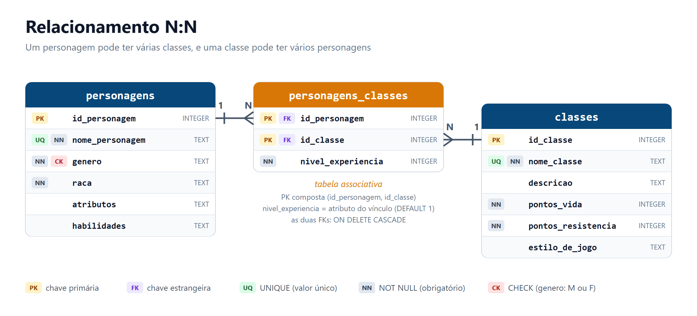

<p align="center">
  
</p>

<h1 align="center">RPG com Python + SQLite</h1>

<p align="center">
  <b>Atividade Prática da 4ª Unidade: Banco de Dados com Python + SQLite</b><br>
  Cadastro de personagens e classes de RPG, com um relacionamento N:N entre eles,<br>
  operado por um menu no terminal.
</p>

---

## 👥 Integrantes

| Nome |
|---|
| Lyan Kaleu - Programa principal |
| Gustavo Calixta - Diagrama ER |
| Henzzo Gabriel - Banco de Dados |

---

## 📑 Sumário

1. [Sobre o projeto](#1-sobre-o-projeto)
2. [Como executar](#2-como-executar)
3. [Organização do código](#3-organização-do-código)
4. [O banco de dados](#4-o-banco-de-dados)
5. [O programa](#5-o-programa)
6. [Conceitos que o projeto demonstra](#6-conceitos-que-o-projeto-demonstra)
7. [Requisitos da atividade × onde estão no código](#7-requisitos-da-atividade--onde-estão-no-código)
8. [Dificuldades e aprendizados](#8-dificuldades-e-aprendizados)

---

## 1. Sobre o projeto

Em um RPG, um **personagem** pode aprender várias **classes** (um elfo pode ser Ladino e Patrulheiro ao mesmo tempo), e uma classe pode ser seguida por vários personagens (vários heróis são Guerreiros). Esse "muitos para muitos" é o relacionamento **N:N**, o centro desta atividade.

O sistema guarda:

- os **personagens** (nome, gênero, raça, atributos, habilidades);
- as **classes** (nome, descrição, pontos de vida, pontos de resistência, estilo de jogo);
- o **vínculo** entre eles, com o **nível de experiência** que aquele personagem tem naquela classe.

Os dados de exemplo misturam personagens criados pelo grupo com personagens de jogos conhecidos (Baldur's Gate 3, Warcraft e Skyrim).

---

## 2. Como executar

**Requisito:** Python **3.10 ou mais novo** (o menu usa `match/case`, que não existe em versões anteriores). Não é preciso instalar nada: `sqlite3` já vem com o Python.

```bash
python main.py
```

Na primeira execução, o programa cria o arquivo `rpg.db`, as tabelas e os dados de exemplo. Nas próximas, ele só abre o banco que já existe.

> **Quer recomeçar do zero?** Apague o `rpg.db` e rode o programa de novo.

---

## 3. Organização do código

```
rpg-sqlite3/
├── main.py                    # menus (while + match/case); nenhum SQL aqui
├── banco.py                   # cria o banco, as tabelas e os dados de exemplo
├── crud/
│   ├── personagens_crud.py    # cadastrar, listar, pesquisar, alterar, excluir
│   ├── classes_crud.py        # o mesmo, para classes
│   └── associacoes_crud.py    # associar, desassociar e listar nos dois sentidos
├── queries.py                 # as 6 consultas com JOIN e agregação
├── utils.py                   # leitura e validação do que o usuário digita
├── tela.py                    # tudo que aparece na tela: menus, listas, mensagens
├── rpg.db                     # o banco (gerado pelo programa)
└── docs/                      # diagrama e imagens deste README
```

**A regra da divisão:** cada arquivo tem um papel só.

| Camada | Arquivos | Tem SQL? | Tem `print`/`input`? |
|---|---|---|---|
| Banco | `banco.py`, `crud/`, `queries.py` | ✅ | ❌ |
| Interface | `main.py`, `tela.py`, `utils.py` | ❌ | ✅ |

Assim o SQL fica todo num lado e a conversa com o usuário no outro. Se um dia o programa ganhar uma interface gráfica, só a camada de interface muda.

**Como os arquivos se conectam:**

```
main.py ──► crud/*.py ──┐
   │                    ├──► banco.py  (a conexão é criada uma vez só)
   └──────► queries.py ─┘
```

O `crud` e o `queries` fazem `from banco import conexao`. Quando um módulo é importado pela primeira vez, o Python executa o arquivo inteiro; nas vezes seguintes, reaproveita o que já carregou. Por isso o `banco.py` roda **uma vez só** e todos usam **a mesma conexão**.

---

## 4. O banco de dados

### 4.1 Diagrama

<p align="center">
  
</p>

> O arquivo-fonte do diagrama é o [`docs/diagrama.svg`](docs/diagrama.svg).

### 4.2 Por que três tabelas?

O SQLite não tem um tipo de coluna "lista de classes". Se tentássemos guardar as classes dentro da tabela `personagens`, teríamos que repetir o personagem uma vez por classe, ou enfiar várias classes num texto só. As duas saídas quebram a busca e a integridade dos dados.

A solução é uma **tabela associativa** (`personagens_classes`): cada linha dela é um vínculo "**este** personagem tem **esta** classe".

```
personagens                 personagens_classes                 classes
id | nome                   id_personagem | id_classe | xp      id | nome
---+----------------        --------------+-----------+---      ---+------------
1  | Lyra Vento-Lâmina ◄────── 1          | 1 ─────────────────► 1  | Ladino
                       ◄────── 1          | 5 ─────────────────► 5  | Patrulheiro
3  | Kaelen do Véu Rubro ◄──── 3          | 1 ─────────────────► 1  | Ladino
```

Lendo da esquerda para a direita: a Lyra tem duas classes. Lendo da direita para a esquerda: o Ladino tem dois personagens. Isso é o N:N.

### 4.3 As tabelas

**`personagens`**

| Coluna | Tipo | Restrições | Para que serve |
|---|---|---|---|
| `id_personagem` | INTEGER | PRIMARY KEY AUTOINCREMENT | identifica o personagem |
| `nome_personagem` | TEXT | NOT NULL, **UNIQUE** | dois heróis não podem ter o mesmo nome |
| `genero` | TEXT | NOT NULL, **CHECK** (`'M'` ou `'F'`) | o banco recusa qualquer outro valor |
| `raca` | TEXT | NOT NULL | Elfo, Anão, Orc... |
| `atributos` | TEXT | — | opcional |
| `habilidades` | TEXT | — | opcional |

**`classes`**

| Coluna | Tipo | Restrições | Para que serve |
|---|---|---|---|
| `id_classe` | INTEGER | PRIMARY KEY AUTOINCREMENT | identifica a classe |
| `nome_classe` | TEXT | NOT NULL, **UNIQUE** | não existem duas classes "Mago" |
| `descricao` | TEXT | — | opcional |
| `pontos_vida` | INTEGER | NOT NULL | número, por isso INTEGER |
| `pontos_resistencia` | INTEGER | NOT NULL | número, por isso INTEGER |
| `estilo_de_jogo` | TEXT | — | opcional |

**`personagens_classes`** (associativa)

| Coluna | Tipo | Restrições | Para que serve |
|---|---|---|---|
| `id_personagem` | INTEGER | NOT NULL, **PK**, **FK** → `personagens` | um lado do vínculo |
| `id_classe` | INTEGER | NOT NULL, **PK**, **FK** → `classes` | o outro lado |
| `nivel_experiencia` | INTEGER | NOT NULL, DEFAULT 1 | dado do próprio vínculo (bônus) |

### 4.4 As restrições, uma por uma

| Restrição | O que garante | Exemplo de erro que ela barra |
|---|---|---|
| **PRIMARY KEY** | cada linha tem um identificador único | — |
| **PK composta** `(id_personagem, id_classe)` | o mesmo vínculo não entra duas vezes | associar a Lyra ao Ladino de novo |
| **FOREIGN KEY** | o vínculo só aponta para algo que existe | associar o herói de id 99, que não existe |
| **NOT NULL** | campo obrigatório | cadastrar uma classe sem nome |
| **UNIQUE** | valor sem repetição | cadastrar outro personagem chamado "Thrall Martelo-da-Perdição" |
| **CHECK** | valor dentro de uma regra | gênero `X` |
| **DEFAULT 1** | valor usado quando nenhum é informado | — |

> **Atenção ao `PRAGMA foreign_keys = ON`.** O SQLite **não verifica chaves estrangeiras por padrão**. Sem esse comando, associar o herói 99 funcionaria sem erro nenhum. Por isso ele roda logo depois de abrir a conexão, no `banco.py`. Ele vale **por conexão**: cada nova conexão precisa ligá-lo de novo.

> **Por que `NOT NULL` também nas colunas da PK composta?** No SQLite, por um comportamento herdado de versões antigas, uma PRIMARY KEY composta aceita NULL. O `NOT NULL` fecha essa brecha.

### 4.5 ON DELETE CASCADE

As duas chaves estrangeiras da associativa usam `ON DELETE CASCADE`:

- **excluir um personagem** apaga junto todos os vínculos dele com classes;
- **excluir uma classe** apaga junto todos os vínculos de personagens com ela.

Escolhemos CASCADE porque um vínculo sem personagem (ou sem classe) não faz sentido nenhum. A alternativa seria **RESTRICT**: o banco recusaria a exclusão enquanto existisse algum vínculo, e o usuário teria que desassociar tudo antes.

### 4.6 Dados de exemplo

Inseridos pelo próprio `banco.py`, **só na primeira execução** (ele confere se a tabela `personagens` está vazia antes de inserir).

- **7 personagens**, **7 classes** e **11 associações** (o mínimo pedido é 5, 5 e 8).
- **4 personagens multiclasse:** Lyra, Thorgar, Kaelen e Thrall.
- **Ladino e Guerreiro têm 3 personagens cada**, mostrando o N:N dos dois lados.
- **O Bardo não tem ninguém, de propósito:** é ele que mostra o efeito do `LEFT JOIN` nas consultas.

---

## 5. O programa

### 5.1 Mapa do menu

```
MENU PRINCIPAL
├── 1 Personagens   → cadastrar · listar · pesquisar · alterar · excluir
├── 2 Classes       → cadastrar · listar · pesquisar · alterar · excluir
├── 3 Associações   → associar · desassociar · classes de um herói · heróis de uma classe
├── 4 Consultas     → as 6 consultas da seção 5.2
└── 0 Sair
```

Cada menu é um `while True` com `match/case`. A opção `0` faz `break` e volta (ou sai, no menu principal).

### 5.2 As consultas (`queries.py`)

| # | Consulta | O que responde | Conceito de SQL |
|---|---|---|---|
| 1 | Fichas completas | qual personagem tem qual classe, e com quanto XP | **JOIN duplo** pela associativa |
| 2 | Resumo por classe | quantos heróis e qual a média de XP de cada classe | **COUNT + AVG + GROUP BY**, **LEFT JOIN** |
| 3 | Heróis por gênero | heróis do gênero que o usuário digitar | JOIN duplo com filtro por **`?`** |
| 4 | Ranking de experiência | XP total de cada herói, do maior para o menor | **SUM + ORDER BY** |
| 5 | Multiclasses | quem tem mais de uma classe, e quais | **HAVING + GROUP_CONCAT** |
| 6 | Classes sem heróis | classes que ninguém segue | **LEFT JOIN + IS NULL** |

**Exemplo comentado, consulta 1:**

```sql
SELECT p.nome_personagem, c.nome_classe, pc.nivel_experiencia
FROM personagens AS p
JOIN personagens_classes AS pc ON pc.id_personagem = p.id_personagem  -- 1º JOIN: personagem → vínculos
JOIN classes AS c ON c.id_classe = pc.id_classe                       -- 2º JOIN: vínculo → classe
ORDER BY p.nome_personagem
```

**JOIN × LEFT JOIN, na consulta 2:** com `JOIN`, o Bardo sumiria do resultado, porque não tem nenhum vínculo para combinar. Com `LEFT JOIN`, toda classe aparece; as que não têm vínculo vêm com contagem 0.

### 5.3 Comandos parametrizados

Todo valor digitado pelo usuário entra no SQL por `?`. O texto do SQL nunca é montado com f-string ou `+`.

```python
# ❌ ERRADO: o texto digitado vira parte do comando SQL
conexao.execute(f"SELECT * FROM personagens WHERE nome_personagem = '{nome}'")

# ✅ CERTO: o valor vai separado, e o sqlite3 trata como dado
conexao.execute("SELECT * FROM personagens WHERE nome_personagem = ?", (nome,))
```

No jeito errado, se alguém digitar `' OR '1'='1`, a consulta vira `... WHERE nome_personagem = '' OR '1'='1'` e devolve **todos** os registros. Esse ataque se chama **SQL injection**. Com `?`, o texto inteiro é tratado só como um nome a procurar.

> **E o `f"%{termo}%"` da pesquisa?** Ali a f-string monta o **valor** do parâmetro (o termo cercado pelos coringas do `LIKE`), não o SQL. O comando continua sendo `... LIKE ?`.

> **Por que `(nome,)` com vírgula?** Os parâmetros precisam ser uma tupla. `(nome)` é só um valor entre parênteses; `(nome,)` é uma tupla de um item.

### 5.4 Tratamento de erros

| Situação | Quem detecta | O que o usuário vê |
|---|---|---|
| Letra no lugar de número | `utils.ler_inteiro` (`ValueError`) | "Isso não é um número, aventureiro!" e a pergunta de novo |
| Campo obrigatório vazio | `utils.ler_texto` | "Este campo não pode ficar vazio!" |
| Gênero diferente de M/F | `utils.ler_genero` | "Digite apenas M ou F!" |
| Nome repetido (UNIQUE) | o banco (`sqlite3.IntegrityError`) | "O banco recusou: UNIQUE constraint failed..." |
| Associação repetida (PK composta) | o banco (`IntegrityError`) | "Este herói já domina essa classe!" |
| Herói ou classe inexistente (FK) | o banco (`IntegrityError`) | "Herói ou classe não existe!" |
| Alterar/excluir id inexistente | `cursor.rowcount == 0` | "Herói não encontrado." |

**Duas camadas de proteção:** o Python valida antes para dar uma mensagem amigável, e as restrições do banco continuam lá como última garantia.

**O que é o `rowcount`:** depois de um `UPDATE` ou `DELETE`, ele diz quantas linhas foram afetadas. Se for 0, o id não existia.

---

## 6. Conceitos que o projeto demonstra

<details>
<summary><b>Por que <code>CREATE TABLE IF NOT EXISTS</code>?</b></summary>

Sem o `IF NOT EXISTS`, a segunda execução daria erro, porque a tabela já existe. Com ele, o comando só cria a tabela se ela ainda não existir. Atenção: ele **não altera** uma tabela que já existe. Mudou a estrutura? Apague o `rpg.db`.
</details>

<details>
<summary><b>Por que <code>commit()</code> depois de cada escrita?</b></summary>

`INSERT`, `UPDATE` e `DELETE` ficam numa transação pendente até o `commit()`. Sem ele, as mudanças somem quando o programa fecha.
</details>

<details>
<summary><b>O que o <code>*</code> faz em <code>cadastrar_personagem(*utils.ler_personagem())</code>?</b></summary>

`ler_personagem()` devolve uma tupla com 5 valores. O `*` "espalha" a tupla, entregando cada valor a um parâmetro da função, na ordem. É o mesmo que escrever `cadastrar_personagem(nome, genero, raca, atributos, habilidades)`.
</details>

<details>
<summary><b>Para que serve o <code>if __name__ == "__main__":</code>?</b></summary>

O bloco só roda quando o arquivo é executado diretamente (`python main.py`). Se outro arquivo importar o `main.py`, o menu não abre sozinho.
</details>

<details>
<summary><b>Por que <code>INTEGER PRIMARY KEY AUTOINCREMENT</code>?</b></summary>

O SQLite gera o id sozinho a cada `INSERT`. Com `AUTOINCREMENT`, um id apagado nunca é reaproveitado. Por causa dele, o banco ganha uma tabela interna chamada `sqlite_sequence`, que guarda o último id usado em cada tabela.
</details>

---

## 7. Requisitos da atividade × onde estão no código

| Requisito | Onde |
|---|---|
| 3 tabelas, uma associativa N:N | `banco.py` |
| PK em todas; PK composta na associativa | `banco.py` |
| FKs + `PRAGMA foreign_keys = ON` | `banco.py` |
| NOT NULL e pelo menos um UNIQUE | `banco.py` (UNIQUE em `nome_personagem` e `nome_classe`) |
| Tipos INTEGER/TEXT/REAL | `banco.py` |
| ON DELETE definido e explicado | `banco.py` + [seção 4.5](#45-on-delete-cascade) |
| ≥ 5 registros por entidade e ≥ 8 associações | `banco.py` (7, 7 e 11) |
| Atributo próprio na associativa (bônus) | `nivel_experiencia` |
| Criação automática do `.db` | `banco.py`, executado no import |
| CRUD completo em 2 entidades | `crud/personagens_crud.py`, `crud/classes_crud.py` |
| Associar, desassociar, listar nos 2 sentidos | `crud/associacoes_crud.py` |
| ≥ 3 consultas com JOIN, uma com JOIN duplo, uma com agregação | `queries.py` (6 consultas) |
| Tudo digitado entra por `?` | `crud/` e `queries.py` |
| Funções com nomes claros, banco separado do menu | [seção 3](#3-organização-do-código) |
| Menu com `while` até sair | `main.py` |
| Diagrama | `docs/diagrama.png` |

---

## 8. Dificuldades e aprendizados

- **Erro na segunda execução.** Os `INSERT` dos dados de exemplo rodavam toda vez, e a segunda execução esbarrava no UNIQUE. *Solução:* conferir se a tabela `personagens` está vazia antes de inserir.
- **`INSERT OR IGNORE` parecia resolver, mas não resolvia.** Depois de excluir um personagem de exemplo, ele voltava com outro id na execução seguinte, e as associações de exemplo apontavam para o id antigo: erro de chave estrangeira, e o programa não abria mais. *Aprendizado:* o `OR IGNORE` ignora UNIQUE, NOT NULL e CHECK, mas **não** ignora FOREIGN KEY.
- **Um erro de digitação que o SQLite aceitava.** Havia uma coluna `INTERGER`, e funcionava, porque o SQLite decide o tipo procurando "INT" dentro do nome. *Aprendizado:* o SQLite é permissivo com tipos; a atenção tem que ser nossa.
- **`UPDATE` na tabela errada.** O alterar de classes apontava para `personagens` e derrubava o programa com `OperationalError`, que o menu não tratava. *Aprendizado:* testar cada opção do menu pelo menos uma vez antes de entregar.

---

<p align="center">
  
</p>
